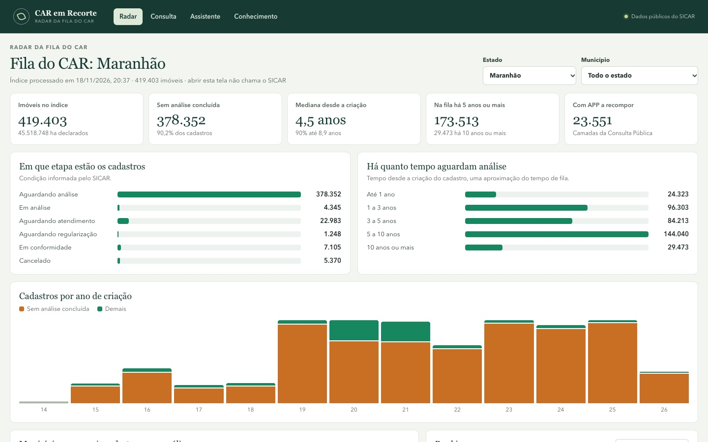
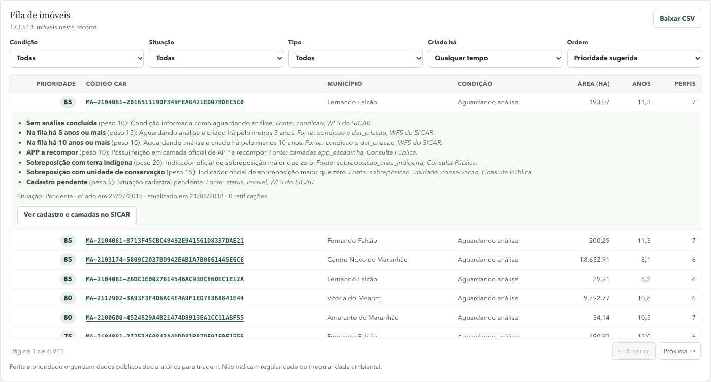
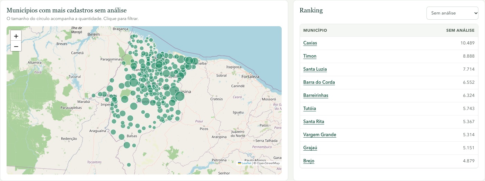
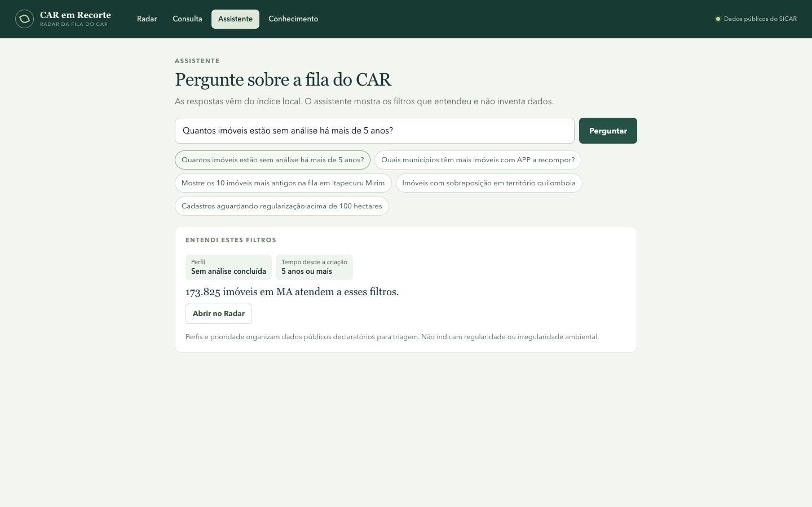
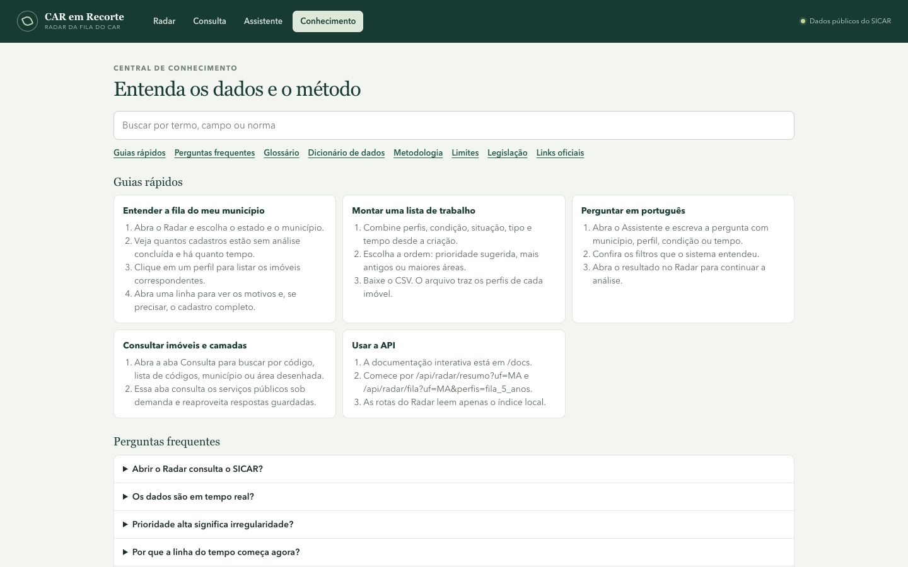

# Radar da Fila do CAR

[](https://github.com/ReinaldoJunior96/radar-fila-car/actions/workflows/testes.yml)
[](LICENSE)

Mostra onde a análise do Cadastro Ambiental Rural está parada e dá acesso granular aos dados públicos do CAR sem sobrecarregar o SICAR.

Protótipo do **CAR em Recorte** para o [Desafio 3 do InovaCAR](https://desafios.enap.gov.br/desafios/inova-car/): acesso granular aos dados do CAR com alta performance.



## O problema

Os dados do CAR são públicos, mas estão espalhados em mapas, downloads, serviços técnicos e painéis agregados. Os painéis públicos consultados não oferecem uma lista navegável de imóveis com tempo de espera e motivos.

No Maranhão, em 18/11/2026:

- **378.352** cadastros aguardavam análise, 90,2% da base.
- **173.513** tinham sido criados há 5 anos ou mais.
- **29.473** tinham sido criados há 10 anos ou mais.
- **23.551** tinham APP a recompor nas camadas públicas.

## O que o sistema faz

| Área | O que entrega |
|---|---|
| **Radar** | Etapas da análise, tempo desde a criação, anos de cadastro, mapa, ranking de municípios, lista priorizada e CSV |
| **Perfis** | 20 perfis com regra, fonte e peso públicos, além de prioridade sugerida de 0 a 100 |
| **Padrões** | Agrupamento K-Means exploratório, com qualidade e estabilidade informadas |
| **Assistente** | Perguntas em português, com os filtros entendidos à vista e sem modelo generativo |
| **Conhecimento** | Guias, glossário, dicionário de dados, metodologia, limites, legislação e links oficiais |
| **Consulta** | Imóvel, lote de até 1.000 códigos, filtros, mapa, CSV e GeoJSON sob demanda |
| **Integração** | API documentada, versão incorporável e origem de dados substituível |

> Os dados do CAR são declaratórios. Perfis e prioridade organizam a triagem e **não indicam regularidade ou irregularidade ambiental**.

<table>
  <tr>
    <td width="50%"></td>
    <td width="50%"></td>
  </tr>
  <tr>
    <td></td>
    <td></td>
  </tr>
</table>

## Como o SICAR é preservado

As telas leem um índice local, sem geometrias. Só a rotina de sincronização consulta os serviços públicos, e com limites.

```text
Serviços públicos do SICAR ──(rotina com orçamento)──> índice local ──> Radar, Assistente, API e embed
            ▲                                                        │
            └────────(Consulta e cadastro completo, sob demanda e com cache)
```

| Ação | Origem | Chamadas ao SICAR |
|---|---|---|
| Abrir e filtrar o Radar, usar o Assistente e a Central | Índice local | Nenhuma |
| Abrir a Consulta ou o cadastro completo de um imóvel | Serviços públicos, com cache | Sob demanda |
| Atualizar o índice | Rotina controlada | Até 600 por dia, por padrão |

A rotina faz uma chamada por vez, espera 10 segundos entre elas, roda das 20:00 às 00:30, retoma de onde parou e pausa se a fonte recusar o acesso. Ela ignora datas alteradas em massa quando o conteúdo do cadastro não mudou.

## Resultados medidos

Maranhão, em 18/11/2026, em ambiente local:

| Item | Resultado |
|---|---|
| Imóveis indexados | 419.401, igual ao total oficial no momento da carga |
| Conferência com o SICAR | 200 imóveis sorteados, nenhuma divergência |
| Carga completa | 509 chamadas e 53,8 MB em 1h52, com 10 s entre chamadas |
| Atualização diária | 2 chamadas e 27 KB |
| Leitura do Radar | 300 requisições e nenhuma chamada ao SICAR |
| Resposta mediana | Resumo em 2,4 ms, fila com perfis em 22,7 ms e assistente em 196,7 ms |
| Índice | 424 MB, com os índices do banco |
| Agrupamento | 7 grupos, silhueta de 0,33 e estabilidade de 0,74 |

Para repetir a medição: `python3 benchmarks/medir_camada.py`.

## Como rodar

Requer Docker com Compose.

```sh
git clone https://github.com/ReinaldoJunior96/radar-fila-car.git
cd radar-fila-car
cp .env.example .env
docker compose up --build -d
```

Depois carregue o índice. Comece por um município para testar:

```sh
docker compose run --rm sync python -m app.sync_indice --uf MA --municipio "Itapecuru Mirim" --retificacoes
```

E então o estado inteiro, o que levou 1h52 no Maranhão:

```sh
docker compose run --rm sync python -m app.sync_indice --uf MA --carga --indicadores --retificacoes
```

- Aplicação: <http://localhost:8080>
- Documentação da API: <http://localhost:8000/docs>
- Versão incorporável: <http://localhost:8080/embed/radar>

Para manter o índice atualizado automaticamente:

```sh
docker compose --profile sync up -d sync
```

## API

| Rota | Uso |
|---|---|
| `GET /api/radar/resumo?uf=MA` | Indicadores da UF ou do município |
| `GET /api/radar/fila` | Imóveis por perfil, condição, situação, tipo, tempo, área e grupo |
| `GET /api/radar/fila/export` | CSV da fila, até 50.000 imóveis |
| `GET /api/radar/municipios` | Indicadores por município |
| `GET /api/radar/evolucao` | Fotografias diárias desde a primeira sincronização |
| `GET /api/radar/grupos` | Padrões encontrados pelo agrupamento |
| `GET /api/perfis` | Regras, fontes e pesos dos perfis |
| `GET /api/assistente?q=...` | Pergunta em português |
| `GET /api/conhecimento` | Conteúdo da central |
| `GET /api/sincronizacao/status` | Situação e custo da sincronização |
| `GET /api/imoveis/{codigo}` | Cadastro, limite e camadas de um imóvel |
| `POST /api/consultas/lote` | Até 1.000 códigos em JSON |
| `GET /api/search` | Busca com filtros e geometrias |
| `GET /api/cache/metricas` | Chamadas feitas e evitadas pelo cache |

Exemplo:

```sh
curl "http://localhost:8000/api/radar/fila?uf=MA&perfis=fila_5_anos,app_recompor&por_pagina=5"
```

## Fontes de dados

| Fonte oficial | Uso |
|---|---|
| [WFS do SICAR](https://geoserver.car.gov.br/geoserver/sicar/wfs?service=WFS&request=GetCapabilities) | Cadastro e limite dos imóveis |
| WFS da [Consulta Pública do CAR](https://consulta.car.gov.br/) | Camadas ambientais, indicadores de sobreposição e retificações |
| API da Consulta Pública | Estados, municípios e data da última carga |

O projeto não automatiza o portal, não contorna captcha e não usa downloads protegidos.

## Estrutura

```text
api/app/
  fonte.py           contrato FonteCar e acesso controlado aos serviços públicos
  sync_indice.py     carga, atualização diária, conferência e recarga
  indice.py          tabelas, gravação, resumos e fotografias diárias
  classificacao.py   perfis e prioridade sugerida
  agrupamento.py     K-Means exploratório
  radar.py           consultas do Radar
  assistente.py      interpretação das perguntas
  sicar.py           consulta sob demanda com cache
  main.py            API FastAPI
api/tests/           testes sem rede
web/                 interface, Radar, Assistente, Central e versão incorporável
docs/                arquitetura, metodologia, operação e integração
benchmarks/          medição de desempenho e de chamadas
```

## Testes

```sh
docker compose run --rm --no-deps -v "$PWD/api/tests:/app/tests:ro" -e PYTHONPATH=/app api \
  python -m unittest discover -s tests -t .
```

Os 26 testes cobrem perfis, hash de mudanças, assistente, proteção contra bloqueio, orçamento, paginação, retomada, conferência de remoções e atualização em massa.

## Limites conhecidos

- O Radar mostra a última sincronização, não o dado do instante.
- O tempo de fila é aproximado pela data de criação, pois os dados públicos não trazem a entrada em cada etapa.
- Os perfis e pesos precisam de revisão por especialistas.
- A linha do tempo começa na primeira sincronização. O índice medido cobre o Maranhão.
- A escala nacional deve usar acesso interno autorizado pelo MGI.
- A integração ao portal oficial depende de decisão do governo.

## Documentação

- [Arquitetura](docs/arquitetura.md)
- [Metodologia](docs/metodologia.md)
- [Operação](docs/operacao.md)
- [Integração com o portal do CAR](docs/integracao-mgi.md)
- [Como contribuir](CONTRIBUTING.md)
- [Segurança](SECURITY.md)

## Licença

[Apache-2.0](LICENSE).
